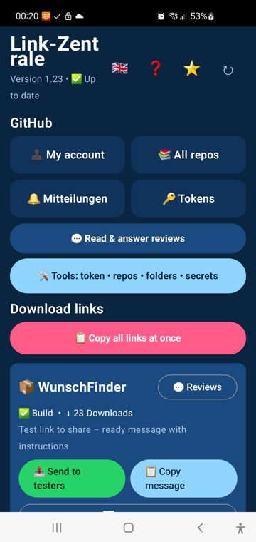
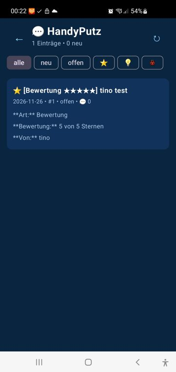
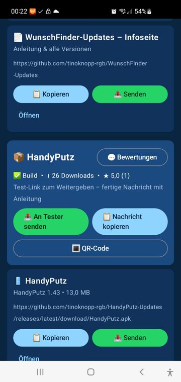
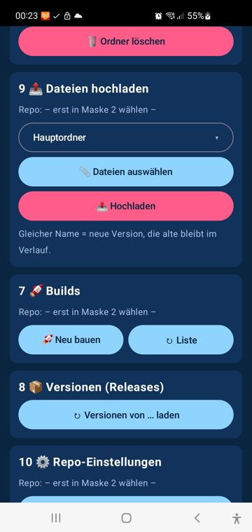

# 🔗 Link-Zentrale

**Your GitHub releases, testers and reviews – in one app.** Android + Windows · Deutsch/English · MIT

Link-Zentrale shows every public repo of a GitHub account that has a release – with share-ready download links, QR codes, reviews (GitHub Issues), download counts, star rating and build status. With your own token it also manages repos, secrets, folders, builds and releases right from your phone.

<p>
   
</p>

## ⬇ Download
| | |
|---|---|
| 📱 Android | [Link-Zentrale.apk](https://github.com/tinoknopp-rgb/Link-Zentrale-Updates/releases/latest/download/Link-Zentrale.apk) |
| 💻 Windows | [Link-Zentrale.exe](https://github.com/tinoknopp-rgb/Link-Zentrale-Updates/releases/latest/download/Link-Zentrale.exe) |
| 🔄 Obtainium | [Add to Obtainium](https://apps.obtainium.imranr.dev/redirect?r=obtainium://add/https://github.com/tinoknopp-rgb/Link-Zentrale-Updates) |

📖 **User guide (Deutsch + English):** [Link-Zentrale-Updates](https://github.com/tinoknopp-rgb/Link-Zentrale-Updates#readme)

## ✨ Features
- 📦 **Project cards** for every repo with a release – one tap to send testers a ready message with link + install guide, or show a **QR code**
- 💬 **Reviews** = GitHub Issues: read, reply, close · unread counter · notifications
- 📊 Downloads, ★ average, open bugs, ✅/❌ last build
- 🛠 **Tools** (with your token): repo links, new repo, **Actions secrets** (encrypted), folders, upload files, start/re-run builds, manage releases, repo settings (public/private, topics), delete repo
- 🔄 Self-update, crash protection with rollback, home-screen widget, Deutsch/English
- 🔐 No account or key built in – you choose the account; your token stays encrypted on your device only

## 🧩 Make your own project appear
Public repo + release with an `.apk/.exe/.zip/.pdf` file. Optional `link-zentrale.json` in the repo:
```json
{ "beschreibung": "Short description", "tester_text": "Please test X.",
  "links": [ { "name": "📘 Manual", "url": "https://…", "info": "Quick guide" } ] }
```

## 🏗 Build it yourself
- **Android:** Kotlin + Jetpack Compose (`app/`) → `./gradlew assembleRelease`
- **Windows:** .NET 8 WinForms (`windows/`) → `dotnet publish windows/LinkZentrale.csproj -c Release`
- **Tests:** `./gradlew testDebugUnitTest` · `dotnet test windows.Tests`
- GitHub Actions (`.github/workflows/build.yml`) builds both, runs tests and publishes to `<owner>/Link-Zentrale-Updates`. Secrets: `UPDATE_TOKEN`, `KEYSTORE_B64`, `KEYSTORE_PASS`.

Contributions welcome – see `CLAUDE.md`/`LINK-ZENTRALE.md` for the house rules (Android + Windows in sync, no hard-coded accounts or keys, tests for new logic).

## License
MIT – see [LICENSE](LICENSE).
